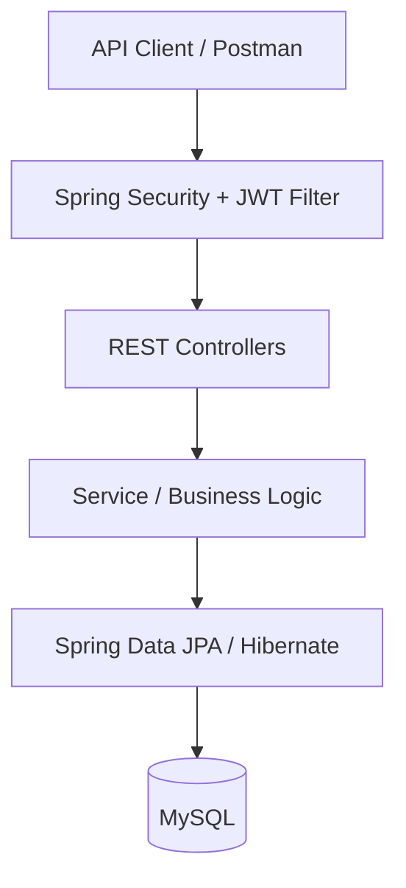

# Multi-Tenant Task Management System

A **backend-only task management REST API** inspired by Jira, built with Java and Spring Boot. The application organizes work across accounts, workspaces, projects, and tasks, with invitation-based collaboration and role-based access control. No frontend is included in this repository; the API can be exercised with Postman or another REST client.

## Features

- **Multi-tenant workspace structure:** support multiple workspaces within an account and multiple projects within each workspace.
- **Team collaboration:** invite users to collaborate and manage their roles and permissions.
- **Task management:** create and organize tasks, assign tasks to team members, set due dates, and update task status through a workflow.
- **Task status workflow:** `BACKLOG`, `TODO`, `IN_PROGRESS`, `IN_REVIEW`, and `DONE`.
- **Authentication and authorization:** secure API access using Spring Security and JWT-based authentication.
- **REST API:** 15+ endpoints for authentication and task, workspace, project, and membership operations.
- **Relational persistence:** store workspace, project, task, and user-related data in MySQL using Spring Data JPA/Hibernate.
- **Input validation:** use Jakarta Bean Validation for validating supported request fields.

## Technology Stack

| Area | Technologies |
|---|---|
| Language | Java 25 |
| Framework | Spring Boot 4.0.3, Spring Web MVC |
| Security | Spring Security, JSON Web Tokens (JWT / JJWT) |
| Persistence | Spring Data JPA, Hibernate |
| Database | MySQL |
| Utilities | Lombok, ModelMapper, Jakarta Bean Validation |
| Build | Maven Wrapper |

## High-Level Architecture



Requests pass through Spring Security/JWT authentication before reaching the REST controllers. Application logic processes workspace/project/task operations, and JPA/Hibernate persists data in MySQL.

## Core Domain Model

```text
Account / Tenant
└── Workspaces
    ├── Members and roles
    └── Projects
        └── Tasks
            ├── Assignee
            ├── Due date
            └── Status
```

The workspace and project structure lets teams organize work while keeping task operations scoped to the relevant workspace/project.

## Getting Started

### Prerequisites

- **JDK 25** (the current `pom.xml` sets `java.version` to `25`)
- MySQL Server
- Git

### 1. Clone the repository

```bash
git clone https://github.com/Safeer99/Multi-tenant-task-manager.git
cd Multi-tenant-task-manager
```

### 2. Create the database

Create the local database in MySQL:

```sql
CREATE DATABASE jira_clone;
```

### 3. Configure the application

Open `src/main/resources/application.properties`. Configure the database URL, username, password, and JWT secret for your local environment. The application currently uses these property names:

```properties
spring.datasource.url=jdbc:mysql://localhost:3306/jira_clone
spring.datasource.username=${DB_USERNAME:root}
spring.datasource.password=${DB_PASSWORD}
jwt.secretkey=${JWT_SECRET_KEY}
```

The `${...}` placeholders read environment variables. If your local `application.properties` still contains hard-coded values, replace those values with the placeholders above. Set `DB_USERNAME`, `DB_PASSWORD`, and `JWT_SECRET_KEY` in your shell or IDE run configuration. Use a strong, random JWT secret of at least 32 bytes; **do not commit real credentials or secrets to Git**.

The project currently uses Hibernate schema update configuration for local development. For production use, prefer controlled database migrations and review all security/configuration settings before deployment.

### 4. Run the application

**Windows PowerShell**

```powershell
$env:DB_USERNAME="root"
$env:DB_PASSWORD="your-mysql-password"
$env:JWT_SECRET_KEY="replace-with-a-long-random-secret-of-at-least-32-characters"
.\mvnw.cmd spring-boot:run
```

**macOS / Linux**

```bash
export DB_USERNAME=root
export DB_PASSWORD='your-mysql-password'
export JWT_SECRET_KEY='replace-with-a-long-random-secret-of-at-least-32-characters'
./mvnw spring-boot:run
```

By default, Spring Boot starts at:

```text
http://localhost:8080
```

### 5. Build and run tests

**Windows:**

```powershell
.\mvnw.cmd clean package
.\mvnw.cmd test
```

**macOS / Linux:**

```bash
./mvnw clean package
./mvnw test
```

## Using the API

This repository contains the backend only. Use Postman, `curl`, or another HTTP client to call the endpoints implemented by the controllers.

Typical workflow:

1. Register or authenticate a user using the authentication endpoints.
2. Use the returned JWT as a bearer token for protected endpoints:

   ```http
   Authorization: Bearer <your-jwt-token>
   ```

3. Create or access a workspace, invite collaborators, and assign appropriate roles.
4. Create projects within a workspace, then create tasks, assign them to members, and update their statuses.

Refer to the controller classes in `src/main/java` for the exact endpoint paths, HTTP methods, request payloads, and response formats.

**Author:** [Safeer Anwar](https://github.com/Safeer99)
